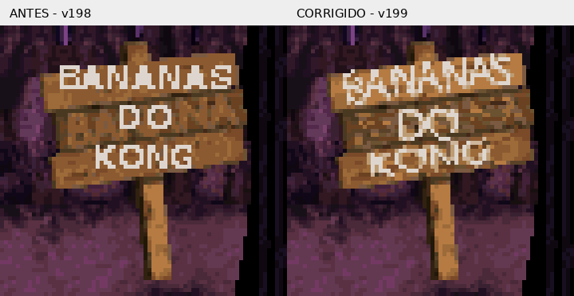
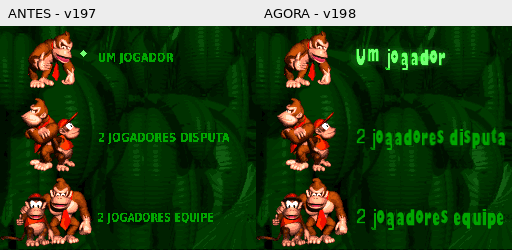

# Donkey Kong Country — Tradução PT-BR

Projeto independente de tradução do **Donkey Kong Country de Super Nintendo**, baseado na ROM americana v1.0.

**Versão atual: v199.** Projeto em desenvolvimento. Os testes documentados cobrem os menus, a entrada na primeira fase e a placa da caverna; uma campanha completa até os créditos ainda não foi certificada.

## Baixar os patches

| Variante | Patch completo para a ROM USA v1.0 |
|---|---|
| Nomes das fases em português | [USA → v199, nomes traduzidos](patches/v199/USA_v1.0_para_v199_TRADUZIDOS.ips) |
| Nomes das fases originais | [USA → v199, nomes originais](patches/v199/USA_v1.0_para_v199_ORIGINAIS.ips) |

Os demais textos estão em português nas duas variantes. Os arquivos completos de ROM e os saves pessoais não são distribuídos neste repositório.

Já usa a v198? Há [patches incrementais e de reversão](patches/v199). Aplique o patch da mesma variante; escolha somente um caminho de atualização.

## O que mudou recentemente

- **v199:** placa “BANANAS / DO / KONG” ajustada à inclinação da madeira, com letras e tons derivados da arte americana.
- **v198:** menus com letras maiores no estilo americano e brilho no item selecionado.
- **v197:** remoção dos pequenos fragmentos verdes próximos às opções de jogadores.





## Como aplicar

Use a sua cópia local da **ROM USA v1.0, de 4.194.304 bytes, sem cabeçalho de copiador**. O SHA-256 de origem é:

```text
fa8cacf5bbfc39ee6bbaa557adf89133d60d42f6cf9e1db30d5a36a469f74d15
```

Aplique um dos IPS completos com um aplicador compatível. Como alternativa, o script abaixo usa somente Python 3, confere a ROM de origem e valida o hash final:

```bash
python3 scripts/aplicar_patch.py \
  --rom /caminho/Donkey_Kong_Country_USA_v1.0.sfc \
  --variante traduzidos \
  --saida local/DKC_PTBR_v199_NOMES_TRADUZIDOS.sfc
```

Para manter os nomes originais das fases, use `--variante originais`. O script cria outro arquivo e não sobrescreve a ROM de origem nem um destino existente.

Guarde cópias dos seus saves. Se o emulador associa o save ao nome da ROM, use uma cópia do `.srm` com o nome correspondente à ROM traduzida.

## Validação e limites

A v199 foi comparada à v198 em duas variantes, com saída e reentrada na caverna. Foram 12 pares de capturas. As diferenças se restringiram à placa; WRAM, SRAM, sprites e paletas permaneceram iguais. Nenhuma campanha completa foi certificada.

- [Relatório v199](docs/relatorios/v199.md)
- [Relatório v198](docs/relatorios/v198.md)
- [Medições v199](evidencias/v199/validacao.csv)
- [Histórico e pendências](CHANGELOG.md)
- [Roteiro de validação no Mesen](docs/VALIDACAO.md)

Os relatórios preservam os nomes de pastas dos checkpoints originais. Neste repositório público, a organização segue a árvore descrita abaixo. Dumps de memória e saves desses checkpoints não foram incluídos.

## Desenvolvimento

```text
patches/          Patches completos, incrementais e reversíveis
scripts/          Aplicação, reconstrução e validação
assets/rebuild/   Dados necessários à reconstrução da placa
docs/             Capturas, relatórios e instruções
evidencias/       Métricas e hashes das versões testadas
```

Para reconstruir a v199 a partir da sua ROM USA, instale as dependências locais e execute:

```bash
python3 -m pip install -r requirements.txt
python3 scripts/recriar_placa_v199.py \
  --original /caminho/Donkey_Kong_Country_USA_v1.0.sfc \
  --saida Recriado
```

O construtor recompõe a v198 com os patches do próprio repositório e então aplica a correção da placa. As ROMs geradas permanecem locais, em pastas ignoradas pelo Git.

Antes de enviar alterações:

```bash
python3 scripts/verificar_repositorio.py
```

O GitHub Actions repete essa verificação e confere a sintaxe dos scripts. Esse processo não executa o jogo e não substitui os testes no emulador.

## Relatar problemas

Abra uma issue com a versão, a variante, o emulador ou hardware, o local do problema e uma captura, se possível. Não envie ROMs, saves ou credenciais. Consulte [CONTRIBUTING.md](CONTRIBUTING.md).

## Créditos e licenciamento

A tradução é um projeto não oficial. O jogo, seus personagens e sua arte original pertencem aos respectivos titulares. As imagens de comparação documentam as alterações gráficas.

Uma licença de redistribuição para o código e os textos próprios deste projeto ainda não foi definida pelo responsável. Nenhuma licença sobre o jogo original é concedida por este repositório.
